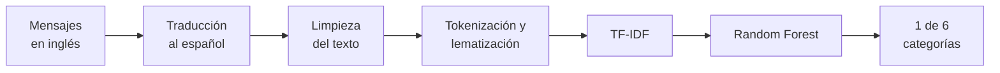

<p align="center">
  
  
  
  
  
</p>

# Clasificación de mensajes de odio en redes sociales

Clasificador multiclase que lee un mensaje en español y decide si es inofensivo o a cuál de cinco tipos de discurso de odio pertenece. Usa **TF-IDF** para convertir el texto en números y **Random Forest** para clasificar, con una accuracy de **0.84**.

Un discurso de odio es un mensaje ofensivo dirigido a una persona o grupo por características como raza, género, religión, orientación sexual u origen nacional. Con el volumen de mensajes que se publican cada día, identificarlos a mano no es viable; un clasificador puede alertar sobre los casos probables para que alguien los revise.

## Resultados

| Métrica | Valor |
| --- | --- |
| Accuracy | **0.84** |
| Precisión ponderada | 0.83 |
| Recall ponderado | 0.84 |
| F1 ponderado | 0.83 |
| Accuracy con validación cruzada (5 pliegues) | 0.83 |



El modelo distingue bien religión, origen y racismo (cerca de 0.90 de precisión). Le cuesta más sexismo y orientación sexual, que son justo las dos clases con menos mensajes después de la limpieza: unos 5,000 cada una, frente a casi 10,000 de las demás.

## Los datos

Se combinaron varias bases públicas de Kaggle, la mayoría con mensajes de X (antes Twitter), en seis categorías:

| Categoría | Mensajes originales | Mensajes tras la limpieza |
| --- | ---: | ---: |
| No odio | 23,053 | 9,978 |
| Religión | 16,088 | 9,968 |
| Racismo | 18,167 | 9,954 |
| Origen y xenofobia | 11,487 | 9,862 |
| Orientación sexual e identidad de género | 18,031 | 5,044 |
| Sexismo | 22,407 | 4,572 |

Los mensajes estaban en inglés. Se tomaron 10,000 ejemplos por categoría y se tradujeron al español con la API de Google Translate. Tras quitar duplicados y textos vacíos quedaron **49,378 mensajes**.

## Cómo funciona



1. **Limpieza.** Se corrigen errores de codificación, se pasa todo a minúsculas y se quitan acentos, signos de puntuación, números y menciones (`@usuario`).
2. **Duplicados.** Se detectan y eliminan mensajes repetidos.
3. **Tokenización, lematización y stemming** con NLTK, para reducir cada palabra a su raíz.
4. **TF-IDF.** Cada mensaje se convierte en un vector que pesa más las palabras distintivas.
5. **Random Forest**, evaluado con validación cruzada de 5 pliegues.

## Experimentos

| Prueba | Accuracy | F1 |
| --- | :---: | :---: |
| Semilla 170119 | 0.839 | 0.833 |
| Semilla 2024 | 0.835 | 0.829 |
| Semilla 123456789 | 0.836 | 0.831 |
| `GridSearchCV` (81 combinaciones, 405 ajustes) | 0.840 | 0.834 |
| **Modelo elegido:** 100 árboles, semilla 170119, sin palabras poco informativas | **0.836** | **0.830** |

Lo que se aprendió:

- **La semilla casi no cambia el resultado.** Las tres divisiones dan entre 0.835 y 0.839, así que el desempeño no depende de una partición afortunada.
- **Ajustar hiperparámetros no compensó.** La mejor combinación (`n_estimators=150`, `min_samples_split=10`) subió la accuracy apenas a 0.840 y su curva de aprendizaje mostraba sobreajuste. Se conservó el modelo más simple.
- **Importa más no acusar en falso.** El modelo es fiable al reconocer mensajes inofensivos, lo que ayuda a evitar sanciones equivocadas.

## Cómo ejecutarlo

```bash
git clone https://github.com/AnnaCUGA/Hate-Speech-Classification.git
cd Hate-Speech-Classification
pip install pandas scikit-learn nltk chardet colorama wordcloud matplotlib seaborn
jupyter notebook "Clasificación de Mensajes de Odio.ipynb"
```

El cuaderno lee `Odioesptrabajado.csv` desde la carpeta donde se ejecuta. Copia ese archivo desde `Bases de Datos/` o ajusta la ruta en las celdas que lo cargan.

## Estructura

```
Clasificación de Mensajes de Odio.ipynb                       Cuaderno con todo el código
Bases de Datos/hate-speech.csv                                Datos originales en inglés
Bases de Datos/mensajeoido.csv, odioesp.csv, df_es.csv        Pasos intermedios y traducción
Bases de Datos/Odioesptrabajado.csv                           Base final, traducida y procesada
Proyecto 2 Clasificación de mensajes en redes sociales.pptx   Presentación
assets/                                                       Gráficas de este README
```

## Limitaciones y siguientes pasos

- Los mensajes son traducciones automáticas del inglés, así que no reflejan del todo cómo se escribe el odio en español (modismos, regionalismos, ironía).
- Sexismo y orientación sexual tienen la mitad de datos que las demás clases; conseguir más ejemplos de esas dos es la mejora más directa.
- TF-IDF ignora el orden y el contexto de las palabras. Un modelo de lenguaje preentrenado en español sería el siguiente experimento natural.

## Equipo

- Ana Cristina Cuevas García
- Derek Saúl Morán Pérez
- Emiliano Vicaña García
